<div align="center">

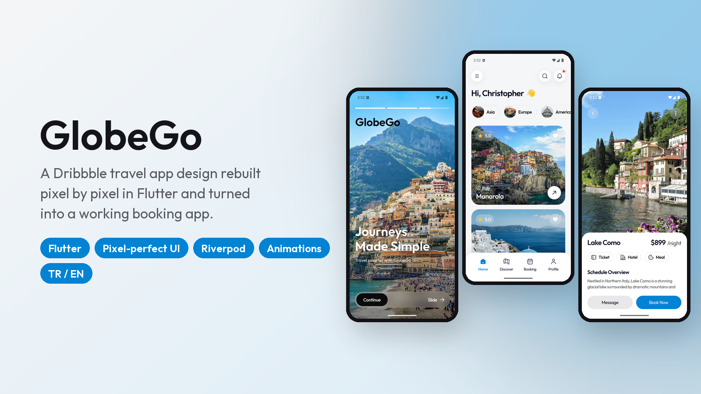

# GlobeGo · Birebir Flutter Arayüzü

Dribbble'daki bir seyahat uygulaması tasarımı Flutter ile **piksel piksel** yeniden yapıldı ve çalışan bir uygulamaya dönüştürüldü. Uygulamada şunlar var:
- Tanıtım ekranı.
- Destinasyonlara göz atma ve favoriler.
- Rezervasyon akışı.
- Ev sahibiyle sohbet.
- Türkçe / İngilizce arayüz.

[](https://flutter.dev)
[](https://riverpod.dev)
[](https://dribbble.com/shots/27654880-Travel-Booking-App-Mobile-UI-UX-Design)
[](https://github.com/SafaSenturk/flutter-travel-app-ui/actions/workflows/ci.yml)
[](LICENSE)

**[⬇️ APK'yı indir](https://github.com/SafaSenturk/flutter-travel-app-ui/releases/latest)** · [🇬🇧 English](#-english)

</div>

---

## Tasarım ve Flutter karşılaştırması

Orijinal tasarım: **[Koushik Sarkar](https://dribbble.com/SARKAR07)**'ın **[Travel Booking App | Mobile UI/UX Design](https://dribbble.com/shots/27654880-Travel-Booking-App-Mobile-UI-UX-Design)** çalışması.
- Üst satır tasarımın kendisi.
- Alt satır bu uygulama; aynı 393 × 852 pt ekrana ayarlanmış Android emülatöründe çalışıyor.

<p align="center">
  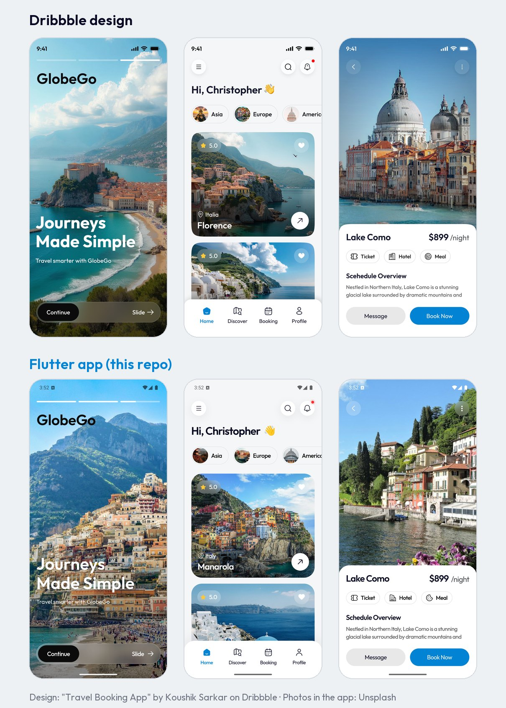
</p>

<p align="center">
  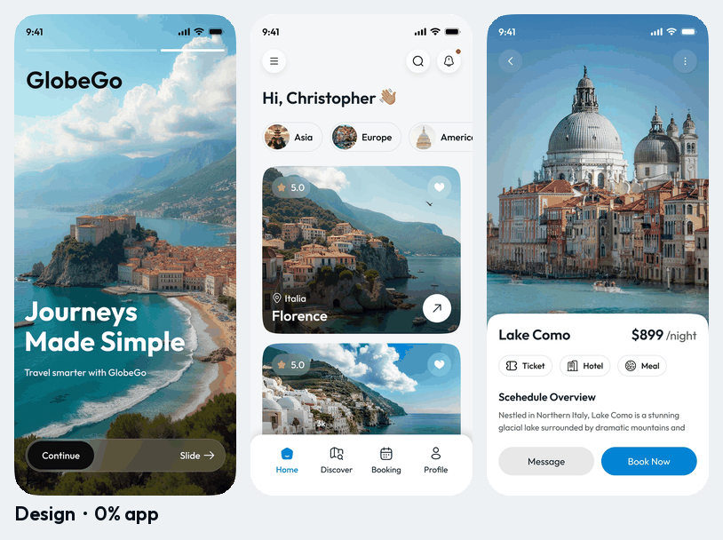<br/>
  <sub>Her tasarım ekranı uygulama ekranına dönüşüyor. Yazılar, düğmeler ve kartlar yerinde kalıyor; yalnızca fotoğraflar değişiyor.</sub>
</p>

### Nasıl birebir yapıldı?

1. **Göz kararı değil, ölçerek.** 3200 × 2400'lük görseli indirip üç telefon ekranını kestim, iPhone'un 393 × 852 pt boyutuna ölçekleyip üstüne 10 pt'lik ızgara çizdim. Koddaki her boyut, boşluk ve köşe yarıçapı bu ızgaradan geliyor:
   - 21 pt sayfa kenar boşluğu.
   - 42 pt başlık düğmeleri.
   - 51 pt bölge çipleri.
   - 30 pt köşeli 296 pt kartlar.
   - Ana ekran çubuğunun üstünde 74 pt'lik sekme çubuğu.
2. **Renkler piksellerden alındı:**
   - Arka plan `#F5F6F7`.
   - Yazı `#080A23`.
   - Vurgu `#0283D3`.
   - Gövde metni `#4A4C4E`.
3. **Tipografi metne göre ayarlandı.** Font Outfit. Boyutlar büyük harf yüksekliklerinden, sıkı harf aralığı (yaklaşık −3,5 %) ise yazı genişliklerinin fontun ölçüleriyle karşılaştırılmasından hesaplandı.
4. **Aynı çerçeve.** Tasarım iPhone üzerinde çizildiği için düzen en az 54 pt üst ve 34 pt alt boşluğu korur. Emülatör `1080 × 2343 @ 440 dpi`'a ayarlandı; bu tam olarak 393 × 852 dp eder.
5. **Betiklerle kontrol edildi** ([`tool/`](tool) klasöründe):
   - `compare.py` ekran görüntüsünü tasarımın üstüne bindirir.
   - `measure.py` her yazının iki görüntüdeki sınırlarını bulur.

Son sürümde ölçülen değerler (pt, tasarım → uygulama):

| Öğe | Sol kenar | Üst kenar | Genişlik |
|---|---|---|---|
| "Asia" çip yazısı | 78.0 → 77.7 | 211.7 → 211.7 | 31.0 → 29.6 |
| Puan "5.0" | 72.3 → 72.3 | 301.0 → 300.7 | 22.7 → 21.7 |
| Arama ikonu | 287.3 → 286.7 | 73.7 → 73.7 | 18.4 → 18.6 |
| Sekme çubuğu ikonları (satır) | 141.3 → 142.0 | 766.3 → 766.3 | 195.0 → 195.0 |
| "Lake Como" başlığı | 23.0 → 22.7 | 558.0 → 557.3 | 124.3 → 121.3 |
| "Ticket" çip içeriği | 34.7 → 35.0 | 614.0 → 614.0 | 68.0 → 68.3 |
| Açıklamanın ilk satırı | 22.3 → 22.0 | 704.3 → 705.0 | 317.4 → 315.3 |
| "Continue" yazısı | 50.3 → 51.7 | 775.3 → 775.3 | 65.0 → 64.0 |

Bilerek farklı bırakılanlar:
- **Fotoğraflar.** Tasarımdaki görseller elde olmadığı için uygulama ücretsiz [Unsplash](https://unsplash.com/license) fotoğrafları kullanıyor.
- **Durum çubuğu.** Durum çubuğu Android'in kendi çubuğu.
- **Küçük düzeltmeler:**
  - "Scehedule" yazım hatası "Schedule" olarak düzeltildi.
  - Lake Como ekranında Como Gölü fotoğrafı var; tasarımda Venedik fotoğrafı kullanılmış.

## Demo

<p align="center">
  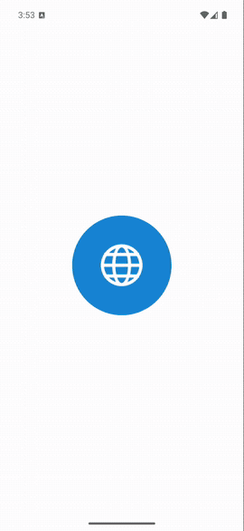
</p>

## Özellikler

Tasarımda üç ekran var. Etrafındaki her şey aynı stilde tasarlanıp çalışır hâle getirildi:

- **Tanıtım (onboarding)**
  - Kendiliğinden ilerleyen hikâye tarzı çubuklar.
  - Fotoğraflarda Ken Burns yakınlaşması; slaytlar arası kaydırma.
  - Gerçek bir **kaydırarak başla** kontrolü: "Continue" düğmesini sona kadar sürükle ya da dokunup sonraki slayda geç.
- **Ana sayfa**
  - Animasyonlu selamlama.
  - Bölge çipleriyle listeyi filtreleme (Asya / Avrupa / Amerika).
  - Kartların sırayla gelişi.
  - Zıplayan favori kalpleri.
  - Nabız gibi atan bildirim noktası ve bildirim paneli.
- **Destinasyon detayı**
  - Karttan Hero geçişi.
  - Buzlu cam düğmeler.
  - Bilet / Otel / Yemek çipleri gerçek **ekstralar**.
  - Açıklama dokununca genişler.
  - ⋮ menüsünde paylaş ve favori.
- **Rezervasyon**
  - Giriş günü, gece ve kişi sayısı seç; değiştirdikçe toplam sayarak güncellenir.
  - Onay penceresi seyahati **Seyahatlerim**'e kaydeder; oradan iptal edebilirsin.
- **Ev sahibiyle sohbet:** yazıyor gecikmesi ve cevaplarıyla hazır sorular, ayrıca serbest metin.
- **Keşfet:** bölge ve favori filtreli, tüm destinasyonları gösteren ızgara.
- **Arama:** iki dilde çalışır; "Kapadokya" da "Cappadocia" da bulunur.
- **Profil:** adını düzenle, istatistikleri gör, dili değiştir, tanıtımı yeniden izle.
- **Türkçe / İngilizce**; tüm metinler ARB dosyalarında. Favoriler, seyahatler, ad ve dil cihazda saklanır.

## Ekran görüntüleri

| Tanıtım | Son slayt | Ana sayfa | Bölge filtresi |
|:---:|:---:|:---:|:---:|
| 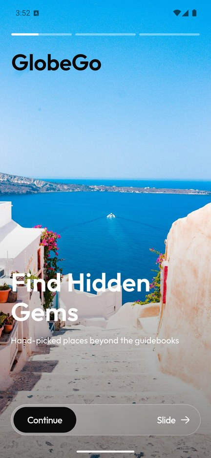 | 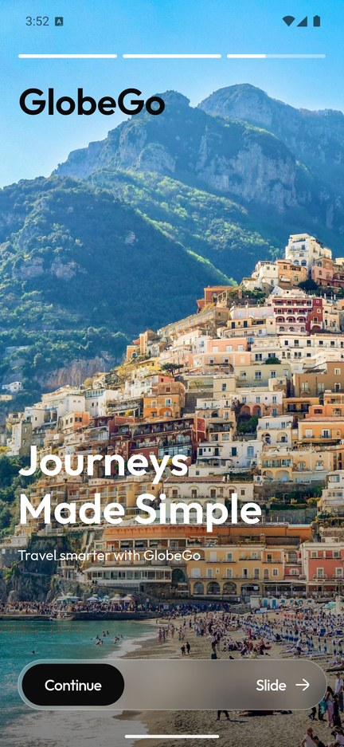 | 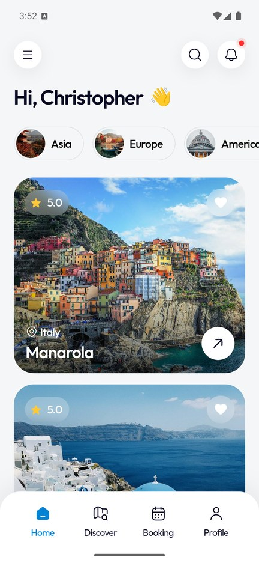 | 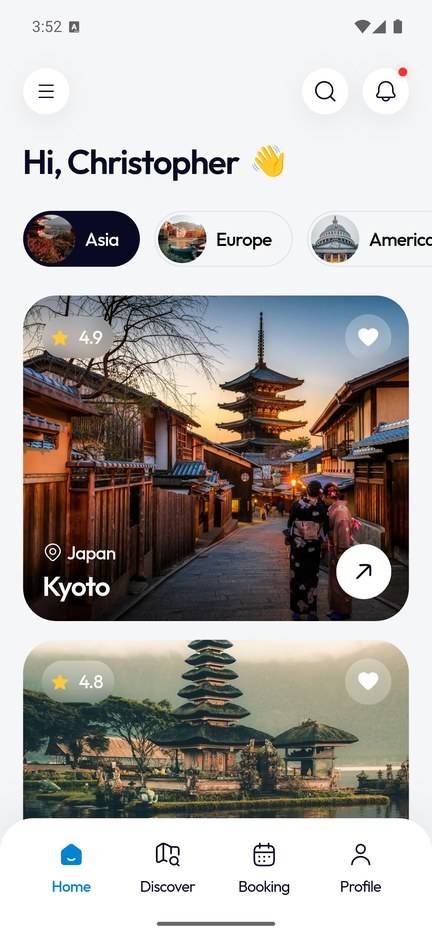 |
| **Arama** | **Detay** | **Ekstralar + açıklama** | **Rezervasyon** |
| 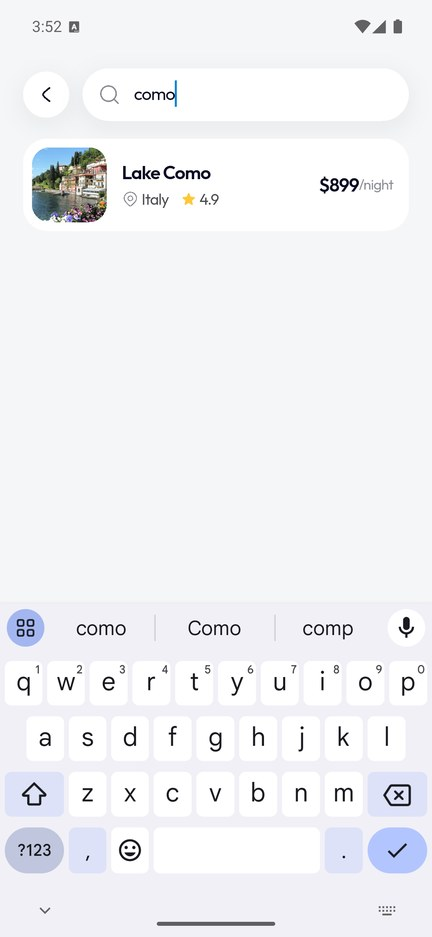 | 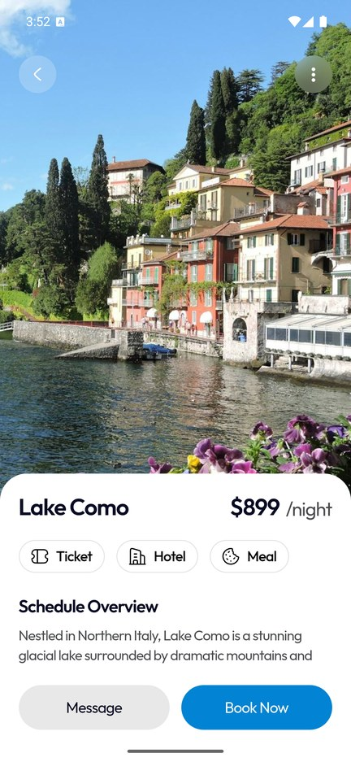 | 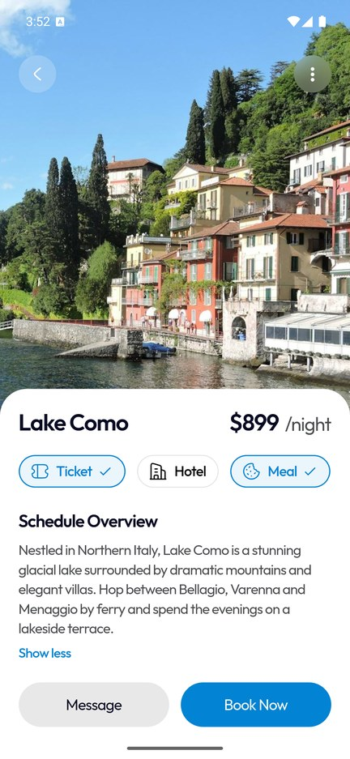 | 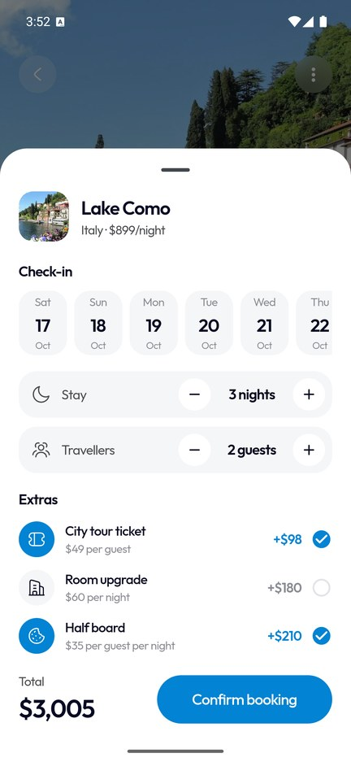 |
| **Onaylandı** | **Seyahatlerim** | **Keşfet** | **Favoriler** |
| 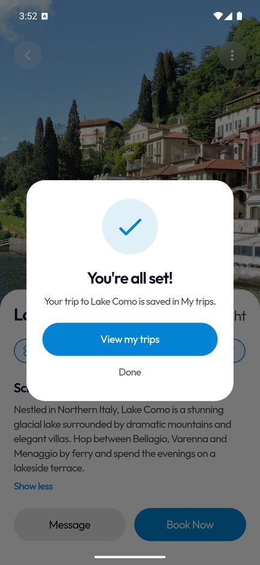 | 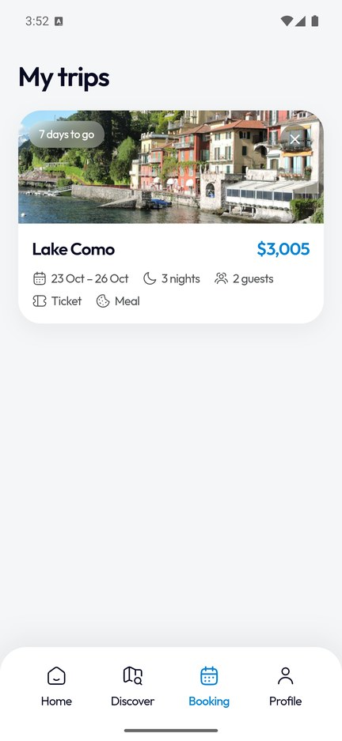 | 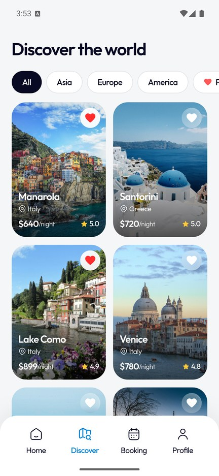 | 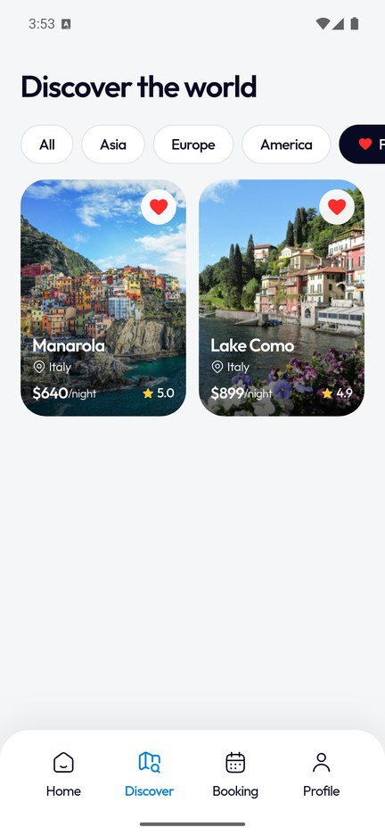 |
| **Ev sahibiyle sohbet** | **Ana sayfa (TR)** | **Detay (TR)** | **Profil (TR)** |
| 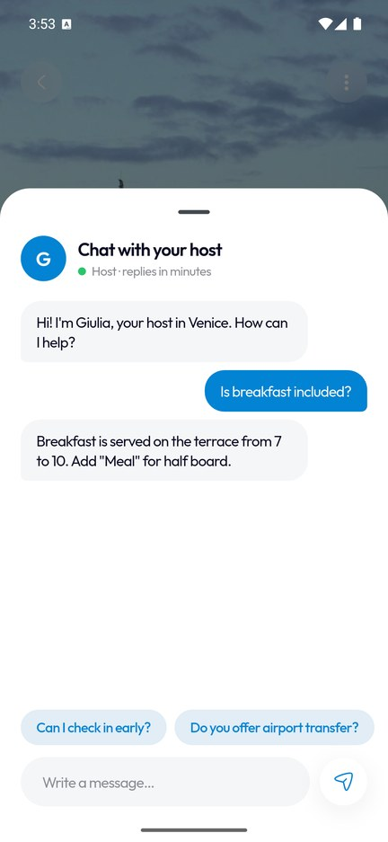 | 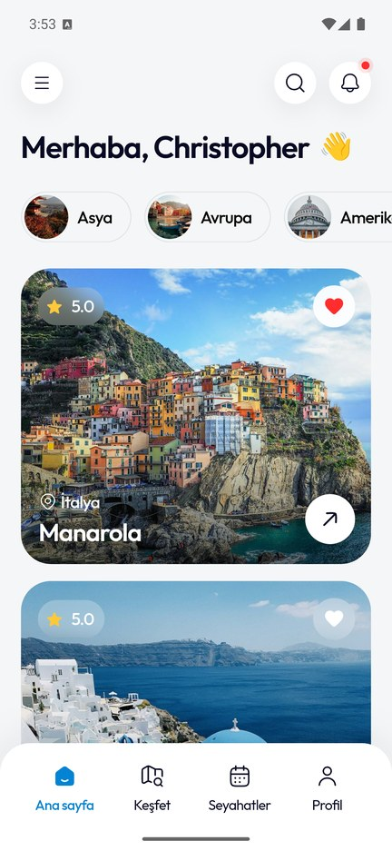 | 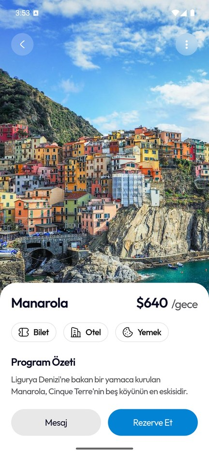 | 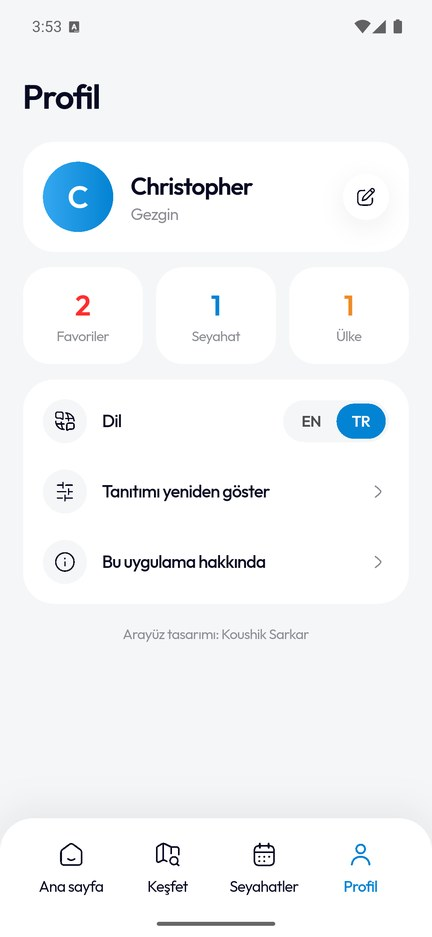 |

## Teknolojiler

| Alan | Seçim |
|---|---|
| Arayüz | Flutter 3.44, Material 3, yalnızca özel widget'lar, sekme çubuğundaki ev ikonu için `CustomPainter`, `BackdropFilter` cam efekti |
| Animasyon | Köşe yarıçapını değiştiren Hero geçişi, örtük animasyonlar, sıralı belirmeler, `AnimationController` ile hikâye çubukları ve kaydırarak başla |
| State management | **Riverpod 3** (dil, tanıtım, favoriler, bölge filtresi ve seyahatler için `Notifier` provider'lar) |
| Saklama | `shared_preferences` (seyahatler JSON olarak) |
| Yerelleştirme | `gen-l10n` ARB dosyaları, Türkçe ve İngilizce, `intl` tarihleri |
| Varlıklar | Uygulamaya gömülü Outfit fontu, Hugeicons, Unsplash fotoğrafları |
| Test / CI | 14 birim ve widget testi (fiyatlandırma, arama, saklama, tanıtım akışı, filtreler, Türkçe arayüz), GitHub Actions |

## Proje yapısı

```
lib/
├── main.dart                 # ProviderScope, MaterialApp, tanıtım ↔ uygulama geçişi
├── core/                     # tema değerleri (renkler, boşluklar, yazı), ortak widget'lar
├── data/destinations.dart    # TR/EN 13 destinasyon, ekstralar ve fiyatlandırma
├── state/providers.dart      # Riverpod notifier'ları + seyahat modeli
├── features/
│   ├── onboarding/           # hikâye çubukları, kaydırarak başla
│   ├── shell/                # sekme çubuğu, yan menü
│   ├── home/                 # başlık, bölge çipleri, destinasyon kartları, bildirimler
│   ├── detail/               # detay ekranı, rezervasyon paneli, ev sahibi sohbeti
│   ├── discover/  booking/  profile/  search/
└── l10n/
tool/                         # tasarım karşılaştırma betikleri (Python + Pillow)
```

## Kendin çalıştır

```bash
git clone https://github.com/SafaSenturk/flutter-travel-app-ui.git
cd flutter-travel-app-ui
flutter pub get
flutter run
flutter test
```

API anahtarı ya da arka uç gerekmez.

Elinde bir Figma ya da Dribbble tasarımı mı var? Onu birebir, animasyonlu ve çalışan bir Flutter uygulamasına dönüştürebilirim: **[safasenturk.github.io](https://safasenturk.github.io)**

## Emeği geçenler

- **Arayüz tasarımı:** [Koushik Sarkar](https://dribbble.com/SARKAR07), [Travel Booking App | Mobile UI/UX Design](https://dribbble.com/shots/27654880-Travel-Booking-App-Mobile-UI-UX-Design). `docs/` içindeki tasarım görselleri yalnızca orijinalle karşılaştırma için gösteriliyor; tüm hakları tasarımcıya aittir.
- **Fotoğraflar:** [Unsplash](https://unsplash.com) fotoğrafçıları, [Unsplash Lisansı](https://unsplash.com/license) ile.
- **Font:** [Outfit](https://fonts.google.com/specimen/Outfit), SIL Open Font License.
- **İkonlar:** [Hugeicons](https://pub.dev/packages/hugeicons), MIT.

### 🧩 Bu projeden çıkan eklentiler

Bu uygulamadaki şu parçaları başka projelerde de kullanılabilsin diye **[Plugins](https://github.com/SafaSenturk/Plugins)** reposuna ekledim. Oradan erişip kendi projene kopyalayabilirsin:

- **[flutter-motion-kit](https://github.com/SafaSenturk/Plugins/tree/main/flutter-motion-kit)**: kaydırarak onayla düğmesi, Pressable, sırayla belirme (Reveal) ve buzlu cam.
- **[flutter-dev-tools](https://github.com/SafaSenturk/Plugins/tree/main/flutter-dev-tools)**: tasarımla piksel karşılaştırma betikleri (compare / measure) ve README görsel araçları.

---

## 🇬🇧 English

**GlobeGo** is a Dribbble travel app design rebuilt **pixel by pixel** in Flutter, then turned into a working app:
- Onboarding.
- Destination browsing and favourites.
- A booking flow.
- A host chat.
- A Turkish / English interface.

The design comparison, demo, screenshots and project structure are shown above. **[⬇️ Download the APK](https://github.com/SafaSenturk/flutter-travel-app-ui/releases/latest)**

### Design vs Flutter

The original shot is **[Travel Booking App | Mobile UI/UX Design](https://dribbble.com/shots/27654880-Travel-Booking-App-Mobile-UI-UX-Design)** by **[Koushik Sarkar](https://dribbble.com/SARKAR07)**. In the comparison image above:
- The top row is the design.
- The bottom row is this app, running on an Android emulator set to the same 393 × 852 pt screen.

#### How it was matched

1. **Measured, not eyeballed.** I downloaded the 3200 × 2400 shot, cut out the three phone screens, scaled them to the iPhone's 393 × 852 pt and drew a 10 pt grid on top. Every size, padding and radius in the code comes from that grid:
   - 21 pt page margin.
   - 42 pt header buttons.
   - 51 pt region chips.
   - 296 pt cards with a 30 pt radius.
   - A tab bar 74 pt tall above the home indicator.
2. **Colours sampled from pixels:**
   - Background `#F5F6F7`.
   - Ink `#080A23`.
   - Accent `#0283D3`.
   - Body text `#4A4C4E`.
3. **Typography fitted to the text.** The font is Outfit. Sizes come from cap heights; the tight letter spacing (about −3.5 %) comes from comparing text widths against the font's metrics.
4. **Same frame.** The design is drawn on an iPhone, so the layout keeps at least a 54 pt top and a 34 pt bottom inset. The emulator was set to `1080 × 2343 @ 440 dpi`, which is exactly 393 × 852 dp.
5. **Checked with scripts** (in [`tool/`](tool)):
   - `compare.py` overlays a screenshot on the design.
   - `measure.py` finds the ink bounding box of each text in both images.

The measurement table (pt, design → app) is in the Turkish section above. Most differences are 1–2 pt.

What is different on purpose:
- **Photos.** The shot's images are not available, so the app uses free [Unsplash](https://unsplash.com/license) photos.
- **Status bar.** The status bar is Android's own.
- **Small fixes:**
  - "Scehedule" is spelled "Schedule".
  - The Lake Como screen shows a photo of Lake Como; the shot uses a Venice picture.

### Features

The design has three screens. Everything around them was designed in the same style and made to work:

- **Onboarding**
  - Story-style progress bars that advance on their own.
  - Ken Burns zoom on the photos; swipe between slides.
  - A real **slide-to-start** control: drag the "Continue" knob to the end, or tap it to go to the next slide.
- **Home**
  - Animated greeting.
  - Region chips filter the list (Asia / Europe / America).
  - Staggered card entrance.
  - Favourite hearts with a bounce.
  - Pulsing notification dot and a notifications sheet.
- **Destination detail**
  - Hero transition from the card.
  - Frosted-glass buttons.
  - Ticket / Hotel / Meal chips are real **add-ons**.
  - The overview expands on tap.
  - Share and favourite in the ⋮ menu.
- **Booking**
  - Pick a check-in day, nights and guests; the total counts up as you change them.
  - A confirmation dialog saves the trip to **My trips**, where you can cancel it.
- **Host chat:** quick questions with typing delay and replies, plus free text.
- **Discover:** a grid of all destinations with region and favourites filters.
- **Search:** works in both languages, so "Kapadokya" and "Cappadocia" both match.
- **Profile:** edit your name, see stats, switch language, replay the intro.
- **Turkish / English**, with every text in ARB files. Favourites, trips, name and language are saved on the device.

### Tech stack

| Area | Choice |
|---|---|
| UI | Flutter 3.44, Material 3, custom widgets only, `CustomPainter` for the tab bar's home icon, `BackdropFilter` glass |
| Animation | Hero with a shuttle that changes the corner radius, implicit animations, staggered reveals, `AnimationController` story bars and slide-to-start |
| State management | **Riverpod 3** (`Notifier` providers for locale, onboarding, favourites, region filter, bookings) |
| Storage | `shared_preferences` (JSON for bookings) |
| Localisation | `gen-l10n` ARB files, Turkish and English, `intl` dates |
| Assets | Outfit font (bundled), Hugeicons, Unsplash photos |
| Testing / CI | 14 unit and widget tests (pricing, search, persistence, onboarding flow, filters, Turkish UI), GitHub Actions |

### Run it yourself

```bash
git clone https://github.com/SafaSenturk/flutter-travel-app-ui.git
cd flutter-travel-app-ui
flutter pub get
flutter run
flutter test
```

No API keys or backend needed.

Have a Figma or Dribbble design? I can turn it into a pixel-perfect, animated, working Flutter app: **[safasenturk.github.io](https://safasenturk.github.io)**

### Credits

- **UI design:** [Travel Booking App | Mobile UI/UX Design](https://dribbble.com/shots/27654880-Travel-Booking-App-Mobile-UI-UX-Design) by [Koushik Sarkar](https://dribbble.com/SARKAR07). The design images in `docs/` are shown only to compare against the original, and all rights to them stay with the designer.
- **Photos:** [Unsplash](https://unsplash.com) photographers, under the [Unsplash License](https://unsplash.com/license).
- **Font:** [Outfit](https://fonts.google.com/specimen/Outfit), SIL Open Font License.
- **Icons:** [Hugeicons](https://pub.dev/packages/hugeicons), MIT.

### 🧩 Reusable plugins from this app

These parts of the app are available in the **[Plugins](https://github.com/SafaSenturk/Plugins)** repo, ready to copy into your own project:

- **[flutter-motion-kit](https://github.com/SafaSenturk/Plugins/tree/main/flutter-motion-kit)**: the slide-to-confirm control, Pressable, staggered Reveal and frosted Glass.
- **[flutter-dev-tools](https://github.com/SafaSenturk/Plugins/tree/main/flutter-dev-tools)**: the pixel comparison scripts (compare / measure) and README image tools.

---

<div align="center">

**[Safa Şentürk](https://github.com/SafaSenturk)** · Flutter Mobil Geliştirici · Flutter Mobile Developer · [Portföy / Portfolio](https://safasenturk.github.io)

</div>
